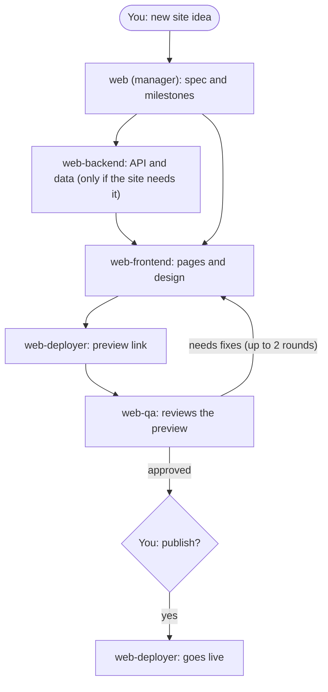
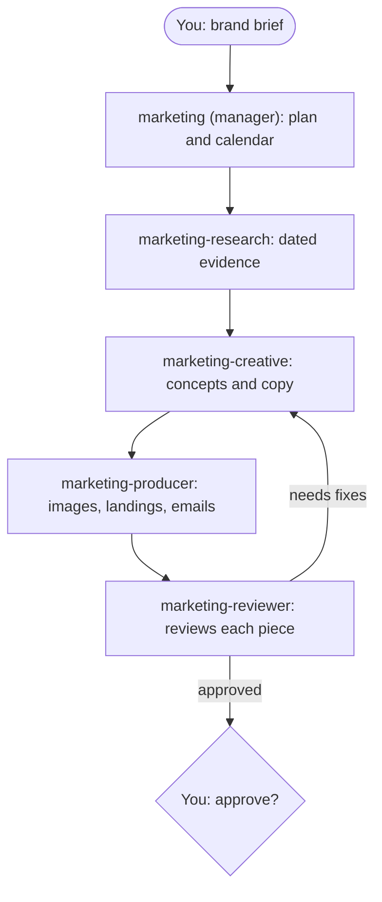
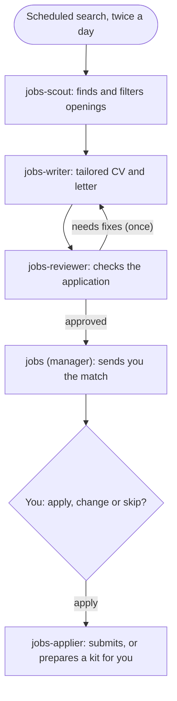

# hermes-agent-squads

[](LICENSE)
[](https://github.com/NousResearch/hermes-agent)

Teams of AI bots ("squads") for [Hermes Agent](https://github.com/NousResearch/hermes-agent) that do real work
for you: build websites, run a brand's marketing, or search and apply for jobs.

You install one bot, the **builder**. You tell it which squads you want, it suggests a model for each bot from
the AI providers you already use, and it installs only what you approve. Later it can create new squads for
your own goals, change existing ones, and keep everything updated.

## What a squad is

- **One manager** you talk to. It turns your request into tasks and asks you only what is yours to decide.
- **A few workers** (frontend, copywriter, reviewer...). Each one does a single job and passes the result to
  the next through a Kanban board, so you never relay messages between them.
- **A reviewer** checks every result before it reaches you.
- **Nothing irreversible without your yes**: publishing, sending, applying, deploying and spending always wait
  for your explicit confirmation.

## Install

You need Hermes Agent with at least one model provider connected (`hermes model`).

```bash
hermes profile install github.com/PuntoyComaTech/hermes-agent-squads --name builder --alias
hermes -p builder model     # choose the builder's own model
builder chat                # then say: "set me up"
```

This creates **only the builder**. When you say "set me up", it asks what to install:

| Choice | What you get |
| --- | --- |
| Only the builder (default) | Nothing else now; ask for a squad whenever you need one |
| Web, Marketing or Jobs | That squad (5 bots each) |
| Everything | The three squads (15 bots) |

Before installing, the builder shows one table with a suggested **model, provider and reasoning effort** for
every bot, picked from the providers you have connected. Accept it or change any bot; nothing is created
until you say OK.

`builder chat` needs `~/.local/bin` on your `PATH`; `hermes -p builder chat` always works.

**Using an AI assistant to install it?** Point it at this repo: it installs the builder only and leaves the
squad and model choices to you ([AGENTS.md](AGENTS.md)).

## Squads

| Squad | You ask for | You get back |
| --- | --- | --- |
| [Web](squads/web/README.md) | "a site for my bakery" | A working site, a preview link to review, and publishing only when you say so |
| [Marketing](squads/marketing/README.md) | "plan my brand's next 90 days" | Research, a 90-day plan, a weekly calendar and reviewed copy and assets |
| [Jobs](squads/jobs/README.md) | your profile and what you look for | Matching openings with a tailored CV and letter; it applies only when you say "apply" |
| Your own | "create a squad for <goal>" | The builder designs it with you (a manager and up to 4 workers) |

### Web



### Marketing



### Jobs



## In the Desktop app

- **Bots tab**: every bot is listed. Managers sit in the `Managers` section; each squad has its own section
  for its workers.
- **Kanban boards**: enable *Capabilities > Plugins > Kanban* to watch the work move. The work runs either way.
- **Projects**: each site, brand or client is a Hermes Project shared by the squad's bots.

## Updates

Ask the builder "what changed upstream?", or run `hermes profile update builder` and then ask it to update
your squads. It shows what would change before touching anything.

## Contributing

[CONTRIBUTING.md](CONTRIBUTING.md). AI agents start at [AGENTS.md](AGENTS.md) and [llms.txt](llms.txt).

## License

MIT. Third-party skills and plugins keep their own licences; the builder shows each one before installing it.
