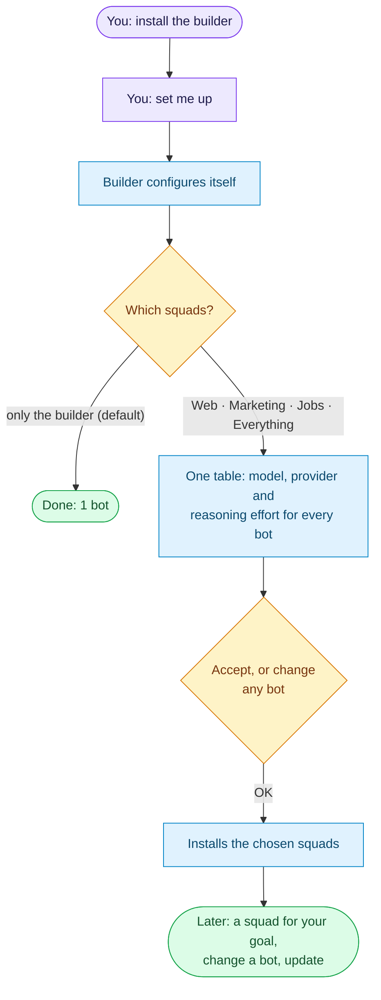

# hermes-agent-squads: AI agent teams for Hermes Agent

[](https://github.com/PuntoyComaTech/hermes-agent-squads/actions/workflows/ci.yml)
[](https://opensource.org/licenses/MIT)
[](https://github.com/NousResearch/hermes-agent)

Ready-to-install teams of AI agents ("squads") for [Hermes Agent](https://github.com/NousResearch/hermes-agent) by
Nous Research. They build websites, run a brand's marketing, and find jobs and write the applications. You talk to
them in plain language; no coding needed.

You install one bot, the **builder**. It asks which squads you want, suggests a model for each bot from the AI
providers you already use, and installs only what you approve. Later it creates squads for your own goals, changes
existing ones and keeps everything updated.

## How the builder works



Nothing is created without your OK, and every squad is optional.

## Install

You need Hermes Agent with at least one model provider connected (`hermes model`).

```bash
hermes profile install github.com/PuntoyComaTech/hermes-agent-squads --name builder --alias
hermes -p builder model     # the builder's own model
builder chat                # then say: "set me up"
```

`builder chat` needs `~/.local/bin` on your `PATH`; `hermes -p builder chat` always works.

**Installing through an AI assistant?** Point it at this repo. It installs the builder only and leaves the squad and
model choices to you ([AGENTS.md](AGENTS.md)).

## Squads

| Squad | What it does | Bots |
| --- | --- | --- |
| [Web](squads/web/README.md) | Builds, reviews and publishes a website or web app | 5 (+1 optional) |
| [Marketing](squads/marketing/README.md) | Plans and produces a brand's marketing, reviewed piece by piece | 5 |
| [Jobs](squads/jobs/README.md) | Finds matching openings and prepares tailored applications | 5 |
| Your own | Ask the builder: "create a squad for &lt;goal&gt;" | 1 manager + up to 4 |

Every squad has one manager you talk to, workers that pass work through a Kanban board, and a reviewer. Publishing,
sending, applying, deploying and spending always wait for your explicit yes.

## FAQ

**What is a squad?** A small team of AI agents in Hermes Agent: one manager you chat with, workers with one job each,
and a reviewer. They coordinate through a Kanban board.

**Do I need to code?** No. You install with three commands and then chat with the builder and the managers.

**Is it free?** Yes, MIT open source. You pay only your own AI provider, if it charges.

**Which AI models does it use?** The ones you already have connected in Hermes Agent (Anthropic, OpenAI, OpenRouter,
local models and others). The builder suggests a model and reasoning effort per bot; you decide.

**Will the agents publish, send or spend on their own?** No. Publishing, sending, applying, deploying and spending
always wait for your explicit yes.

**Can I make my own squad?** Yes. Tell the builder your goal; it designs the squad with you and installs it.

**What do I need?** Hermes Agent 0.22 or newer (macOS, Linux or Windows) and one connected model provider.

## Updates

Ask the builder "what changed upstream?", or run `hermes profile update builder` and ask it to update your squads.
It shows what would change before touching anything.

## Contributing

See [CONTRIBUTING.md](CONTRIBUTING.md). AI coding agents: read [AGENTS.md](AGENTS.md) and [llms.txt](llms.txt).

## License

MIT. Third-party skills and plugins keep their own licences; the builder shows each one before installing it.

---

<div align="center">

Developed by **PuntoyComaTech**

[](https://www.instagram.com/puntoycomatech)
[](https://x.com/PuntoyComaTech)
[](https://www.youtube.com/@PuntoyComaTech)
[](https://www.tiktok.com/@puntoycomatech)

AI teams that work for you inside Hermes Agent.

</div>
