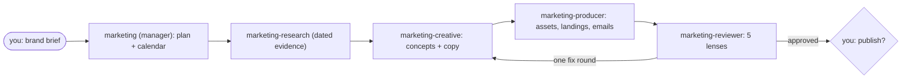
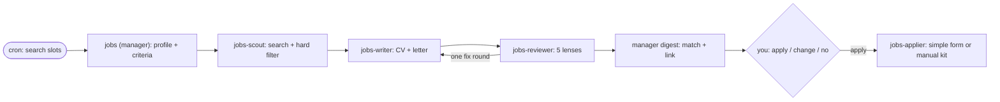

# hermes-agent-squads

[](LICENSE)
[](https://github.com/NousResearch/hermes-agent)

Ready-to-install **AI agent squads for [Hermes Agent](https://github.com/NousResearch/hermes-agent)**:
web development, marketing and job search, plus a **builder** that installs them,
creates new ones with you and keeps everything updated. The repo root is the builder's
**profile distribution**: one command installs it, one command updates it.

Each squad is one manager (the only bot you talk to) plus workers that pass work
along a Kanban board; every bot is visible in the Desktop. Irreversible steps
(apply, publish, send, deploy) always wait for your explicit yes.

## Install (3 commands)

```bash
hermes profile install github.com/PuntoyComaTech/hermes-agent-squads --name builder --alias
hermes -p builder model        # pick the builder's model (interactive, once)
builder chat                   # say "set me up" -> the builder runs squadctl apply --self
```

The `--alias` wrapper is written to `~/.local/bin`; keep that directory on your `PATH` to
use the short `builder chat` form (`hermes -p builder chat` always works).

You need Hermes Agent with a connected model provider, a machine that stays on for
automations, and (optional) a messaging platform where the managers deliver results.

The install creates one profile, `builder`. The builder suggests a model per bot from your
connected providers and shows a diff before every change. Updates: ask the builder "what
changed upstream", or run `hermes profile update builder`.

## Desktop setup

1. **Kanban plugin.** Enable Capabilities > Plugins > **Kanban** to see the boards
   (it ships disabled by default; the dispatcher runs in the gateway regardless).
2. **Bots pane.** The Bots tab is your roster: every bot is visible — Hermes (default),
   the builder and each squad's bots. The `Managers` section holds the squad managers,
   one section per squad holds its workers (sections come from each squad's manifest).
3. **Rail.** The profile rail lists every profile (a full install has 17 profiles including the
   default) and condenses into a dropdown above 13; use Cmd+K > *Toggle profile rail* and switch
   in the Bots pane.
4. **Projects.** Each site, brand or client is a Hermes Project; the builder registers it
   in the manager and the workers (`squadctl project add`), and the Desktop groups sessions
   by project.

## Squads

| Squad | Board | You get | Bots |
| --- | --- | --- | --- |
| [Web](squads/web/README.md) | `web` | Sites from idea to production behind a quality gate, preview link before publishing | manager, frontend, backend, qa, deployer, frontend-pro (optional) |
| [Marketing](squads/marketing/README.md) | `marketing` | Dated research, 90-day plans, copy and assets for your brands, five-lens review | manager, research, creative, producer, reviewer |
| [Jobs](squads/jobs/README.md) | `jobs` | Matching openings with tailored applications; "apply" sends (or a manual kit) | manager, scout, writer, reviewer, applier |
| Yours | - | Ask the builder: "create a squad for <goal>" | up to 5 |

### Web

```mermaid
flowchart LR
    U([you: "new site: idea"]) --> L["web (manager): spec + milestones"]
    L --> C["chain card 1: api (if backend)"] --> F["chain card 2: ui"]
    F --> P["chain card 3: preview"] --> Q["web-qa: 5 lenses"]
    Q -->|fail: fix card, max 2 rounds| F
    Q -->|pass| A{"you: publish?"}
    A -->|"yes"| D["web-deployer: GitHub, DNS, rollback"]
```

### Marketing



### Jobs



## How work flows

A card is one bounded job; each stage creates the next as a dependent card
(`--parent`), so work moves without you relaying anything. Reviewers send fixable findings
back as fix cards (rounds per squad in the diagrams above), then the manager asks you only what
is yours to decide. Cron jobs run behind zero-LLM gates: a quiet tick costs nothing.

## For AI agents

Read [`AGENTS.md`](AGENTS.md) first (repository map in its last section); short index in
[`llms.txt`](llms.txt). Verified Hermes behavior is in `skills/hermes-platform/references/`
(every fact cites its docs path). Contributions: [`CONTRIBUTING.md`](CONTRIBUTING.md), or ask
your builder: it can propose them with your OK.

## License

MIT. Third-party skills and plugins keep their own licences; the builder quotes each one
before installing it.
