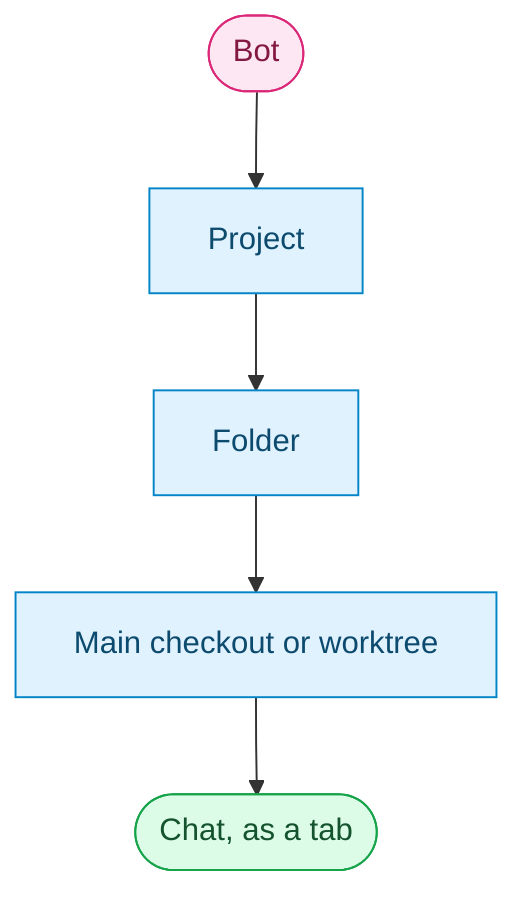
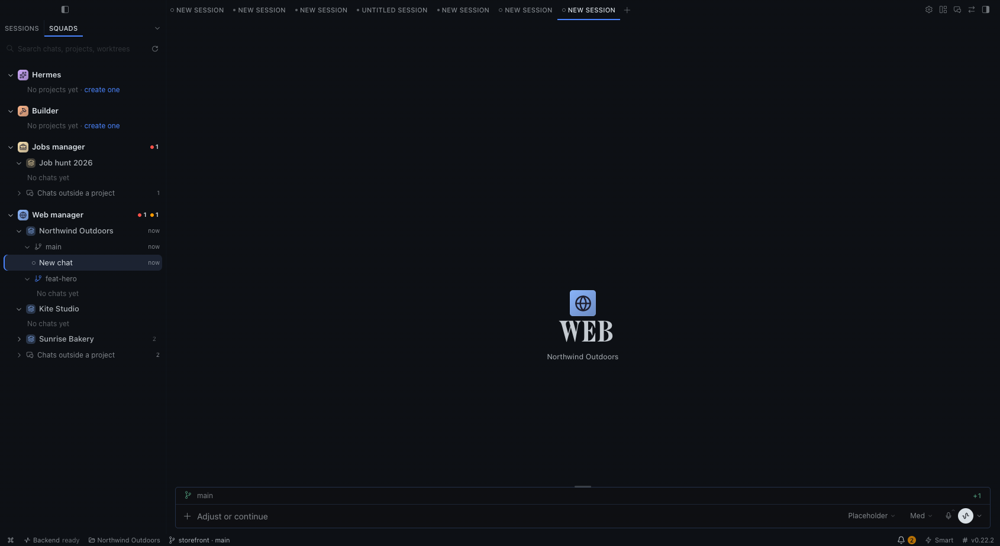
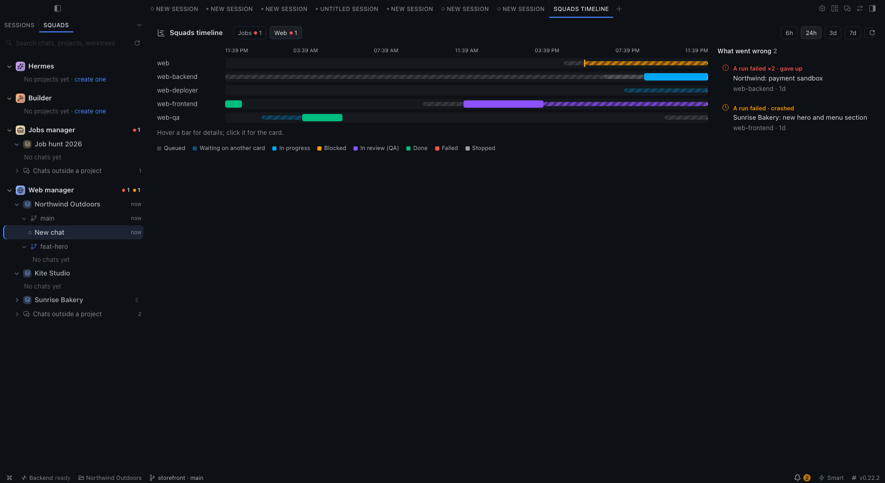
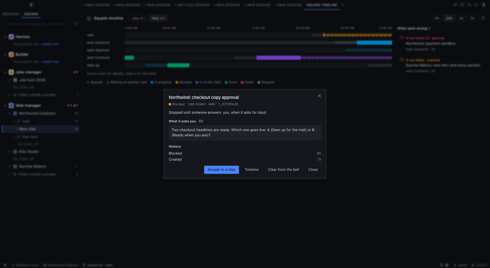

# Hermes Agent Squads Hub

Catalog key: `squad-hub` (`hermes plugins install squad-hub`).

A Hermes Desktop plugin for the squads way of working, part of
[Hermes Agent Squads](https://github.com/PuntoyComaTech/hermes-agent-squads). The Desktop list, bell and timeline
are off until you turn the plugin on in **Capabilities > Plugins**; the agent half (questions with buttons, cards in
replies) runs on every squad manager once `squadctl apply` installs it.

Screenshots use invented projects and boards.

- **One list, no profile switch.** A chat opens as a tab under its own bot, so several bots and projects stay open
  side by side. Opening one never reloads the window.
- **Desktop's own controls stay.** The profile selector and the Bots tab are still there; hide them in the plugin
  settings if Squads is all you use.
- **Only the bots you talk to.** Default, the builder and squad managers; squad workers never show. A bot filed alone
  in its own Desktop section stands beside the managers; any other bot shows under "Other bots" only while it has chats. Hide or pin any of them in Settings > Plugins > Hermes Agent Squads Hub.
- **Projects with several folders, each with its own worktrees.** "+" on a project, folder or worktree starts a chat
  right there; "New worktree" makes a checkout under `.worktrees/` with its own branch.
- **Previews you can bring back.** Every preview a chat opens is remembered (it follows the chat if it is compressed
  into a new session); the status-bar chip, the chat's menu, the command palette and the shortcut list them and a click
  reopens one, no prompt to the bot. Nothing reopens by itself: a preview you closed stays closed, and entering a chat
  never adds a tab.
- **Clean up a project.** "Clean up…" in a project's menu (and on its own view) lists what can go: worktrees with
  nothing to lose (no uncommitted files, nothing unpushed, no chat that needs you, no open or draft PR; kanban
  checkouts never), ticked when their PR is merged or closed or they were not used for 2 days, and chats not used for
  2 days, plus the idle chats of a worktree that goes. You see every row, untick what you want to keep, and one button
  does it. Chats are archived; a removed worktree frees its disk space and keeps its branch, so no commit is lost.
  Working, unread, in-view and pinned chats stay.
- **A bot's own pages in one click.** Scheduled jobs, messaging, Kanban and capabilities (capabilities open in a
  dialog pinned to that bot, with a picker for the other bots of its squad, so a connector or skill of any of them is
  one click away).
- **Quiet big projects.** A closed project lists the chats that are working, unread or open right under its own row,
  each with the folder (and worktree) it lives in: one click opens the chat, no folder to unfold. Open the project and
  that list goes away: each chat shows once, in its own folder, and the folders holding a chat that needs you start
  unfolded while the quiet ones stay folded; a project with more than three
  folders opens in the list's own view instead, with a back button. Single-folder projects open whole. A bot without
  projects lists what needs you and its three newest chats; the rest fold under "Older chats". Fold a whole bot or squad and its pending chats stay listed under it, each tagged with the worktree, folder
  or project it lives in (the full path on hover). Your own open/closed choice always wins.
- **Floating sides (on by default).** The left list and the right
  files/terminal column take no width: bring the pointer within about 40 px of a screen edge and they slide over the chat like an
  auto-hiding dock, then hide a moment after it leaves (never while you type in them or a menu is open). The title-bar
  side buttons, ⌘B and ⌘J dock a side (the chat narrows to make room, and it stays docked after a restart) or release
  it to float again. Drag a shown side's inner edge to resize it (double-click resets); the width is kept. The chat keeps a small margin so the edges stay free. The width you drag
  between the chat and a preview is kept. It works over a preview too, and whatever your layout; a side that cannot float keeps Desktop's own button.
- **Squads layout.** The **Squads** layout (Layout editor in the title bar) puts files over a short terminal on the right.
- **Env files.** A project's `.env` files hold secrets, so Desktop's viewer refuses them. Double-click one in the file
  tree (a switch in the settings), or use "Env files…" on a folder or project, and it opens in your system editor; the
  plugin never reads it.
- **Everything that needs you, one key away.** The status bar counts chats working or unread across every bot (click
  for the list); `⌘⇧U` jumps to the next one. A new chat shows whose it is and where it works. `@` in the composer
  offers the project's folders and worktrees. A project's menu opens the browser and sets the project's icon and
  colour (shared with Sessions); projects wear a filled tile, folders a line glyph (a house for the main folder).
- **A look of its own.** Each bot wears a Lucide icon read from what it does (globe for Web, hammer for the
  builder, shopping bag for a store); change any of them in the plugin settings. A local squad that has no manager
  yet shows as one group, its bots under it. The plugin also ships the **Squads** theme (Catppuccin-inspired, low
  contrast, Inter), on every bot by default: Desktop keeps a theme per bot, so the plugin puts it back on each one;
  turn that off in the plugin settings to pick a theme per bot. Lucide's licence: `LICENSE-lucide.txt`.
- **Squads at work.** A manager's row says what its board holds, in words: "3 waiting on you" (cards blocked for your answer that are
  still in the bell), else "8 waiting on you · seen" (cleared from the bell, still unanswered), "2 running" or "1 in review". A click lists those cards, each opening with the
  question it asks and a button to answer; "Open the timeline" at the bottom opens the
  **timeline**: one lane per bot over the last 6 h, 24 h, 3 days or a week. Bars use one legend, the same as the cards:
  queued, waiting on another card, in progress, blocked, in review (QA), done, failed, stopped; striped while a card
  waits, solid while a bot works. **What went wrong** sits beside it: Hermes' own Kanban diagnostics plus failed runs,
  long waits and cards waiting on you. A click on a bar or an issue opens the card. Read-only; "Squads: open the
  timeline" in the command palette opens it too.
- **The bell.** A bell in the status bar counts what waits on you: cards blocked for your answer on every board, and
  chats asking a question or an approval in every bot with a chat open. Grouped by board, newest first, with its age. A click opens the
  chat, or the card's detail: what it asks you, its history, and **Answer in a chat** (a new chat with the board's
  manager, the card named in the draft). Clear one or **Clear all**; a card comes back only if it blocks again. With
  Hermes in the background a system notification (and a line from the pet, if one is out) tells you a new card needs
  you; a switch turns it off.
- **Pull requests per worktree.** An open folder's main checkout and worktrees show their PR (open, draft, merged) and
  uncommitted changes; a click opens the PR.
- **Cards in the chat.** A manager that files or reports a Kanban card shows it as a live card (state, assignee,
  summary, details and the timeline). The agent half of the plugin adds the card when the reply forgot it, in Desktop
  chats only. The Kanban page link shows only when Desktop's Kanban plugin is on.
- **Questions you click.** The agent half tells every manager to ask with suggested answers (Hermes' `clarify`), so you
  pick one instead of typing "ok": buttons in Desktop and Discord, numbered buttons in Telegram. It reaches new chats
  (a chat keeps the prompt it started with); off for scheduled runs, webhooks and squad workers. A manager opts out
  with `plugins: {disable: [squad-hub]}` in its squad.yaml.
- **Desktop's own Kanban board stays.** Its sidebar row shows (Hermes keeps improving that board), and on a Hermes with
  the card badge slot (after 0.22.5) a card that waits on you wears a red **Needs you** badge there.
- **A quieter window.** Any sidebar row can be hidden in the plugin's settings.

Every change to Desktop's own window (floating sides, hidden Bots tab and profile selector, hidden sidebar rows, the
`.env` double-click) is a switch in **Settings > Plugins > Hermes Agent Squads Hub**.

Not changed by the plugin: the Sessions tab, Files, Review, Terminal, artifacts, cron and the Kanban board itself (the
plugin only reads it).

Two halves. The desktop half is one file (`desktop/plugin.js`): a disk plugin loads uncompiled and resolves only
`@hermes/plugin-sdk`, `react` and `react/jsx-runtime`. The agent half (`__init__.py`) is a prompt section and two hooks
(`post_tool_call`, `transform_llm_output`). `squadctl apply` copies the package into every manager and enables the
agent half (a bot that stops being a manager gets it disabled); Desktop copies the desktop half to its own plugins
folder, off until you turn it on.
`tests/test_squad_hub_model.py` runs the desktop model under node; `tests/test_squad_hub_agent.py` the agent half.

## Credits

Made by **PuntoyComaTech**, part of [Hermes Agent Squads](https://github.com/PuntoyComaTech/hermes-agent-squads) (MIT).
Icons: [Lucide](https://lucide.dev) (ISC). Follow along:
[GitHub](https://github.com/PuntoyComaTech) ·
[Instagram](https://www.instagram.com/puntoycomatech) ·
[X](https://x.com/PuntoyComaTech) ·
[YouTube](https://www.youtube.com/@PuntoyComaTech) ·
[TikTok](https://www.tiktok.com/@puntoycomatech)
