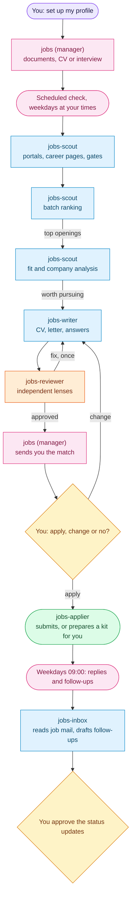

# Jobs squad: AI job search and applications for Hermes Agent

**A job search built around one person: their CV, stage, languages, market and goals. It applies when you say
"apply", or on its own within daily caps once you choose automatic applying.**

[← All squads](../../README.md)

The manager builds your profile once, from your documents, a pasted CV or an interview: career stage, age only if
you want it used, language levels (CEFR), work authorization per country, the market's CV conventions, deal-breakers
and what energizes you. Twice a day the squad searches portals and career pages, gates every opening against that
profile, ranks the batch, analyzes the best ones, writes a tailored application and reviews it before you see it. You
reply `apply`, `change: <what>` or `no` in the manager's chat.

## How it works

"Worth pursuing" means a score at or above `apply_threshold`, with no failed gate (eligibility, language, location)
and no deal-breaker. The score weights are yours to change in `profile.md`.

## What makes it personal

- **Career stage** shapes the CV: a first job leads with education and projects, a career change with transferable
  skills, a senior profile with scope and impact, a return after a gap with one honest line.
- **Languages** are CEFR levels. An opening asking for a language you did not declare is discarded; one asking a bit
  more than your level is flagged for you to decide, never silently dropped.
- **Market conventions**: photo, age, marital status, page count and date format follow the country you apply in.
  Age and photo never appear unless you say so.
- **Eligibility**: citizenship, residency or sponsorship wording is checked against your situation per country.
- **Your voice**: tone, formality and phrases to avoid apply to every letter, answer and follow-up.

## What you can ask

| You say | What happens |
| --- | --- |
| `set up my profile` | Reads `documents/`, a pasted CV or interviews you; searches start once `profile.md` exists |
| `<job link>` | The scout checks that opening and it follows the same chain |
| `rank my openings` | Batch triage of saved openings; the best go to full analysis |
| `apply to <id>` | The applier submits the form (LinkedIn Easy Apply included), or prepares a manual kit |
| `I applied` / `they called me` / `rejected` | Records the outcome and offers interview prep or a thank-you note |
| `any replies?` | The inbox bot reads job mail and proposes status updates; nothing changes until you approve |
| `show my pipeline` | An offline dashboard: funnel, scores, deadlines, shortlist, timelines |
| `what should I learn?` | Skill gaps across the openings you saw, with a study plan |
| `add <board> for <country>` | A guided setup for a local job board |
| `pause search` | Stops the scheduled search until you resume it |

## Bots

| Bot | Does |
| --- | --- |
| `jobs` (manager) | Profile onboarding, digests, decisions, outcomes, dashboard, upskilling. Holds your personal data; delegates, researches and sets things up for the squad |
| `jobs-scout` | Portal, LinkedIn hiring-post and career-page search, gates, batch ranking, fit and company analysis |
| `jobs-writer` | CV, letter, answers and interview prep from verified achievements; renders PDF, DOCX and ATS text; optimises your own LinkedIn profile |
| `jobs-reviewer` | Lenses for truthfulness, ATS, recruiter, hiring manager and writing, plus market and language checks |
| `jobs-applier` | Submits within your apply mode and daily caps, LinkedIn Easy Apply included; otherwise writes a manual kit |
| `jobs-inbox` (optional) | Reads job mail through Gmail: replies, follow-up drafts, verification codes. No web, no browser, never sends |

`contact.yaml` is used by `jobs-writer` (documents) and `jobs-applier` (forms). Gmail is connected to `jobs-inbox` only,
the bot with no web and no browser; it reads and drafts, and never sends. `jobs-inbox` is optional:
`squadctl apply jobs --with jobs-inbox`.

## What the computer needs

- Portal search: [Bun](https://bun.sh) (`bun --version`). The shipped portals have no dependencies to install.
- PDF: WeasyPrint (`pip install weasyprint`) or Chromium/Chrome. DOCX is optional (`pip install python-docx`); without
  it the writer ships the PDF and ATS text and says `docx_skipped`. Text-layer checks: pypdf or
  poppler (`pdftotext`, `pdfinfo`). Without them the writer says what is missing; nothing is installed for you.
- The shared browser: `squadctl apply` installs it as a background service; you sign in once in the window the
  builder opens on request (`scripts/hpy shared_browser.py login <url>`).
- Mail: `hermes connectors connect gmail`, once, if you want reply tracking (`jobs-inbox`).
- One search is one Hermes Project, in a folder you choose. In the Desktop app: Sessions, pick `jobs` in the bottom
  selector, then "+" (New project), and start the search in a chat inside it.

## Schedule

| Job | When | Does |
| --- | --- | --- |
| `jobs-search` | hourly gate; a search at each of the project's `search_times` on weekdays (default 12:00, its `timezone`), reading only postings since the previous check | One search card per active project; nothing until the project and `profile.md` exist |
| `jobs-followups` | weekdays 09:00 | One inbox card (for `jobs-inbox`) when an application went quiet past `follow_up_days`; silent otherwise |
| `jobs-watch` | every 30 min | Tells you when a card waits on you or stalls |

Change the times through the builder; it keeps them in your local overlay.

## LinkedIn and your profiles

| You say | What happens |
| --- | --- |
| `which job sites fit my city?` | The scout researches the platforms that matter where you can work and writes a dated list with its evidence |
| `scan the market` | The scout reads recent LinkedIn hiring posts and the portals, and counts what recent postings ask for |
| `optimize my LinkedIn` | The writer reads your own profile, drafts better copy from your verified achievements and shows you each change; it edits a field only after you approve it, then re-reads to check |

- **One signed-in browser for every bot.** You sign in once (ask the builder for the sign-in window); the scout, writer and
  applier then reuse that session, each in its own tab, closed when it finishes. Nothing holds your password.
- **Reading is light and read-only.** The scout opens LinkedIn hiring-post search only, a few searches a day; job
  listings come from the public portal tool. The writer opens only your own profile. A tool refuses every other page.
- **Your Google data stays out of reach.** The bots' browser cannot resolve Gmail, Drive, Docs, passwords, payments,
  activity, Gemini and other Google apps (`scripts/shared_browser.py`, `GOOGLE_PRIVATE_HOSTS`). The sign-in page
  (accounts.google.com) stays reachable, so the bots' skills forbid consent screens and account settings.
- **Risk:** LinkedIn's terms restrict automated access. A notice, verification or CAPTCHA stops all LinkedIn work for
  the day and tells you; the squad never types a password or solves a check. `linkedin_browse: false` switches it off.
- **Other platforms:** the platform list comes from research per country. A recommended board the squad cannot search
  is added with `add <board> for <country>`; otherwise the writer adapts your profile text to its fields.

## Applying

`auto_apply` in `profile.md` is asked once. `auto` is a standing yes: an approved opening with eligibility passed and a
fit at or above your threshold is submitted at once, up to `daily_apply_cap` (10) per day and `daily_easy_apply_cap`
(5) LinkedIn Easy Apply per day. You are told the company, the role, the CV used and the link. A form the squad cannot
finish becomes a question to you or a manual kit. `try` and `ask` need your "apply" per opening; `never` writes kits.

## Job boards

Shipped: LinkedIn public listings and freehire (country-agnostic), and Computrabajo, elempleo and Talent.com (Latin America, plain HTTP). A board for
your market is added with `add <board> for <country>`: the manager walks through a small command-line tool and its
`portal.json`, tested before it is enabled. Boards are switched on or off in `portal.json`.

## Files

| Path | Contents |
| --- | --- |
| `squad.yaml` | Manifest: bots, lanes, toolsets, skills, board, cron, chains |
| `souls/` | One SOUL per bot |
| `skills/jobs-contract/` | Shared rules, file formats and tools: `job_key`, `posting_guard`, `fetch_page`, `robots_check`, `status`, `seen_state`, `salary_lookup`, `tracker`, `build_dashboard`, `skill_gaps` |
| `skills/` | `leading-job-search`, `profiling-candidates`, `finding-jobs`, `searching-portals`, `adding-portals`, `ranking-openings`, `analyzing-jobs`, `writing-applications`, `rendering-cv`, `preparing-interviews`, `reviewing-applications`, `submitting-applications`, `triaging-inbox`, `tracking-outcomes`, `planning-upskilling` |
| `scripts/start_search.py` | Schedule gate: one search card per slot, paused by `profile.md -> search: paused` |
| `scripts/followup_gate.py` | Follow-up gate: one inbox card per project per day, only when something is due |
| `skills/rendering-cv/` | HTML templates, `render_cv.py`, `verify_pdf.py`, `verify_layout.py` |

Your project folder holds personal data (`contact.yaml`, `documents/`, `tracker.csv`): keep it out of any public
repository.

---

Developed by **PuntoyComaTech**

