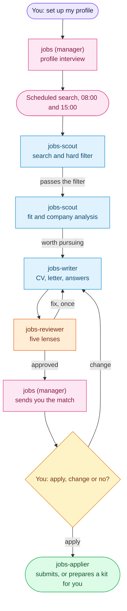

# Jobs squad: AI job search and applications for Hermes Agent

**Matching openings with a tailored CV and letter. It applies only when you say "apply".**

[← All squads](../../README.md)

The manager interviews you once about your profile and what you look for. Twice a day the squad searches, filters
and analyzes openings, writes a tailored application and reviews it before you see it. You reply `apply`,
`change: <what>` or `no` in the manager's chat.

## How it works

"Worth pursuing" means a score at or above `apply_threshold` in your profile.

## What you can ask

| You say | What happens |
| --- | --- |
| `set up my profile` | The profile interview; searches start once `profile.md` exists |
| `<job link>` | The scout checks that opening and it follows the same chain |
| `apply to <id>` | The applier submits a simple form, or prepares a manual kit |
| `how is my search going?` | Matches, applications and their status |
| `pause search` | Stops the scheduled search until you resume it |

## Bots

| Bot | Does |
| --- | --- |
| `jobs` (manager) | Profile interview, digests, apply, change or no decisions, tracking. Holds your personal data; no web access |
| `jobs-scout` | Searches, applies the hard filter, saves the opening, then analyzes fit and the company |
| `jobs-writer` | CV, letter and answers from verified achievements; renders PDF, DOCX and ATS text |
| `jobs-reviewer` | Five lenses: truthfulness, ATS, recruiter, hiring manager, writing |
| `jobs-applier` (optional) | Submits a simple form only after your explicit "apply"; otherwise writes a manual kit |

Only `jobs-writer` and `jobs-applier` read `contact.yaml`. `linkedin.com` is blocked for the scout and the applier.

Without the applier (`scripts/squadctl apply jobs --bots jobs,jobs-scout,jobs-writer,jobs-reviewer`), "apply" answers
with the link and the ready answers.

## What the computer needs

- PDF: WeasyPrint (`pip install weasyprint`) or Chromium/Chrome. DOCX: python-docx. Page counts: `pdfinfo`
  (poppler). Without them the writer tells you what is missing; nothing is installed for you.
- One search is one Hermes Project: `scripts/squadctl project add jobs <name> <path>`.

## Schedule

| Job | When | Does |
| --- | --- | --- |
| `jobs-search` | 08:00 and 15:00 | One search card per slot; nothing until the project and `profile.md` exist |
| `jobs-watch` | every 30 min | Tells you when a card waits on you or stalls |

Change the search times through the builder; it keeps them in your local overlay.

## Files

| Path | Contents |
| --- | --- |
| `squad.yaml` | Manifest: bots, lanes, toolsets, skills, board, cron, chains |
| `souls/` | One SOUL per bot |
| `skills/` | `jobs-contract` (shared rules), `leading-job-search`, `finding-jobs`, `analyzing-jobs`, `writing-applications`, `rendering-cv`, `preparing-interviews`, `reviewing-applications`, `submitting-applications` |
| `scripts/start_search.py` | Schedule gate: one search card per slot, paused by `profile.md -> search: paused` |
| `skills/rendering-cv/scripts/render_cv.py` | CV renderer: HTML, text, PDF, DOCX and `render_report.json` |

The community `job-search` plugin is searchable (`scripts/hpy catalog_search.py job-search`) and stays off by default.

---

Developed by **PuntoyComaTech**

