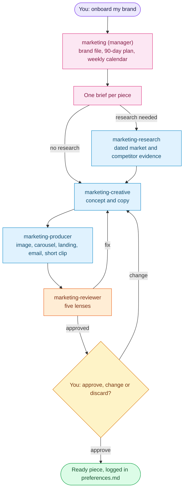

# Marketing squad: AI marketing team for Hermes Agent

**Your brand's marketing, planned and produced, reviewed piece by piece.**

[← All squads](../../README.md)

A manager and four workers run a brand's cycle: onboarding, a 90-day plan, a weekly calendar, reviewed pieces and a
monthly report. You approve, request changes or discard from the manager's chat. The squad never publishes, sends,
schedules or spends without your explicit OK for that action.

## How it works



- Review rounds are capped by `brand.md -> reviewer_rounds`; then the same card is re-reviewed or escalated to you.
- A change request starts a new round with your literal wording.
- A publish step exists only when `brand.md -> publishing` names a connector and you confirmed that piece.

## What you can ask

| You say | What happens |
| --- | --- |
| `onboard my brand` | Questions about the brand, then `brand.md` as a draft until you approve it |
| `plan next week` | Next week's calendar, one brief per piece |
| `make a piece: <idea>` | One piece through the chain above |
| `monthly report` | A report from the data you drop in the brand's `data/inbox/` |
| `status` | Per brand: pieces in progress and what waits for you |

## Bots

| Bot | Does |
| --- | --- |
| `marketing` (manager) | Onboarding, 90-day plan, calendar, briefs, approvals and reports |
| `marketing-research` | Dated market, competitor and ad-library evidence |
| `marketing-creative` | Concepts, all copy and scripts; no web access |
| `marketing-producer` | Statics, carousels, landings, emails, documents and short HyperFrames clips |
| `marketing-reviewer` | Five lenses: brief fit, voice, claims, persuasion and format specs |

## Brands

One brand is one Hermes Project: `scripts/squadctl project add marketing "<Brand>" <path>`. `brand.md` stays `draft`
until you approve onboarding; only `active` brands get calendars and reports. A `PAUSE` file in the brand folder stops
its schedule.

## Schedule

| Job | When | Does |
| --- | --- | --- |
| `marketing-plan-week` | Mondays 08:00 | One calendar card per active brand missing next week's calendar |
| `marketing-report` | the 1st, 08:00 | One report card per active brand whose `data/inbox/` changed |
| `marketing-watch` | every 30 min | Tells you when a card waits on you or stalls |

## File a piece by hand

```sh
scripts/squadctl chain marketing piece --project <slug> --title "<piece title>" --run-id <piece-id> [--when research]
```

## Not included

Publishing, sending, scheduling or ad spend (you do it); full websites (Web squad); long video or 3D. Ad accounts,
pixels and connectors are added per brand. File layout, card fields and rules: skill `brand-contract`. Licences:
[skills/LICENSES.md](skills/LICENSES.md).

---

<div align="center">

Developed by **PuntoyComaTech**

[](https://www.instagram.com/puntoycomatech)
[](https://x.com/PuntoyComaTech)
[](https://www.youtube.com/@PuntoyComaTech)
[](https://www.tiktok.com/@puntoycomatech)
[](https://www.linkedin.com/in/gabriel-rubio99/)

</div>
