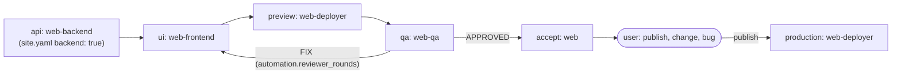

# Squad: Web

## Purpose

Someone who does not program gets a website or web app built, reviewed and live. The user describes a site, approves a plan, checks a preview and says "publish".

Each site is its own project folder and GitHub repository. Nothing reaches production, DNS, money or data without the user's explicit answer for that action.

## What the user sees

```text
Panaderia Sol, preview ready (milestone 1 of 3: home and menu)
https://m1-panaderia-sol.example.workers.dev
- Home with opening hours and the map
- Menu page, in Spanish and English
- Loads in 1.2 s on a phone; no accessibility errors
Screenshot attached.
Reply: "publish", "change: ...", "bug: ... + screenshot"
```

| The user says | What happens |
|---|---|
| `new site: a page for my bakery with the menu` | Plain-language questions in rounds of at most 5, then a plan: pages, stack in one line, milestones, monthly cost |
| `ok` | The plan is approved and the first milestone runs: backend if any, frontend, preview, QA, acceptance |
| `publish` | One Yes/No question naming what goes live and its cost; on "yes": merge, production deploy, live URL |
| `change: add a gallery`, `bug: the form does not send` | A new work item and a new preview |
| `connect my domain` | The planned DNS records, a Yes/No question, then the change and HTTPS |
| `rollback` | After one Yes/No question, the previous version is live again |
| `status` | Per site: current milestone, last preview, live URL, what waits for the user |

## Bots

One manager (`web`) and four workers, plus the optional `web-frontend-pro` (3D, WebGL and complex motion; it installs only with `squadctl apply web --with web-frontend-pro`): `squad.yaml -> bots`. All bots are visible; the manager is filed under `Managers`, the workers under the `Web` section. Models come from the lanes in `scripts/data/model-roles.yaml`; `web-backend` runs `code-routine` and the manager pins the `code-complex` model per card on hard problems (skill `leading-web` step 6).

## Stack

Stacks, site types and pinned versions: `skills/building-frontend/scripts/stacks.json`. Hosting is Cloudflare by default; a server-rendered site past the free tier needs the paid Workers plan, stated in the plan and in the publish question.

## Chain: milestone



`production` runs only with the user's literal confirmation in the card.

## Cron

`web-watch` runs the builder's `scripts/board_watch.py` on the manager (`squad.yaml -> bots.web.cron`): it posts to the manager's Bot Chat when a card waits on the user or stalls.

## What the computer needs

- Accounts the user creates: GitHub and Cloudflare (free tiers). The deployer guides a fine-grained GitHub token and a scoped Cloudflare token; both stay in its environment.
- Node 22+, pnpm, git, `gh`, `cf` and Chrome. Playwright, axe-core and Lighthouse install inside each site repo.

## Files

| File | Contents |
|---|---|
| `squad.yaml` | Manifest: bots, lanes, chains, cron, keeps |
| `souls/` | One SOUL per bot |
| `skills/` | `leading-web`, `building-frontend`, `building-backend`, `reviewing-sites`, `deploying-sites`, `site-contract` |
| `skills/building-frontend/scripts/` | `scaffold_site.py`, `stacks.json` |
| `skills/site-contract/scripts/` | `check_site.py` |

## Extras

The web bots cover sites, not taste: nobody in the repo ships site-cloning, reverse-engineering or
personal-style skills. Add your own extras to a bot's `skills.keep` through the builder
("add skill <name> to web-frontend"), and apply them with `squadctl apply web`.
