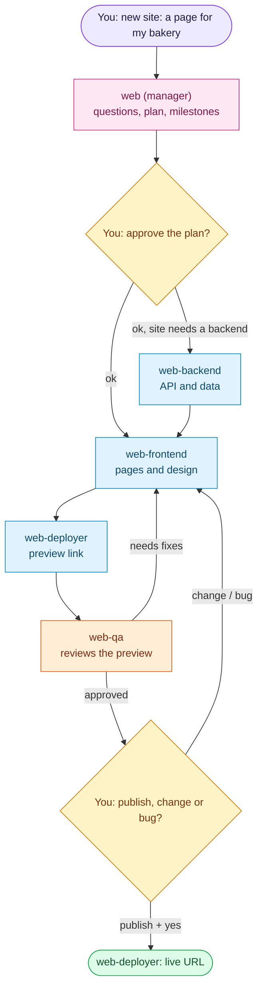

# Web squad

**Describe a site, approve a plan, check a preview, say "publish".**

[← All squads](../../README.md)

Someone who does not program gets a website or web app built, reviewed and live. Each site is its own project folder
and GitHub repository. Nothing reaches production, DNS, money or data without your explicit answer for that action.

## How it works



QA rounds are capped by `automation.reviewer_rounds`. The production deploy runs only with your literal confirmation
in the card.

## What you see

```text
Panaderia Sol, preview ready (milestone 1 of 3: home and menu)
https://m1-panaderia-sol.example.workers.dev
- Home with opening hours and the map
- Menu page, in Spanish and English
- Loads in 1.2 s on a phone; no accessibility errors
Screenshot attached.
Reply: "publish", "change: ...", "bug: ... + screenshot"
```

| You say | What happens |
| --- | --- |
| `new site: a page for my bakery with the menu` | Plain-language questions in rounds of at most 5, then a plan: pages, stack in one line, milestones, monthly cost |
| `ok` | The plan is approved and the first milestone runs |
| `publish` | One Yes/No question naming what goes live and its cost; on "yes": merge, production deploy, live URL |
| `change: add a gallery`, `bug: the form does not send` | A new work item and a new preview |
| `connect my domain` | The planned DNS records, a Yes/No question, then the change and HTTPS |
| `rollback` | After one Yes/No question, the previous version is live again |
| `status` | Per site: current milestone, last preview, live URL, what waits for you |

## Bots

| Bot | Does |
| --- | --- |
| `web` (manager) | Interviews you, writes `spec.md`, plans milestones, files the work, triages changes and accepts results |
| `web-frontend` | UI, design system, motion and scroll animation |
| `web-backend` | APIs, data, auth and tests; the manager gives it a stronger model per card on hard problems |
| `web-qa` | Reviews each preview with five lenses and never fixes what it reviews |
| `web-deployer` | GitHub flow, preview and production deploys, DNS and rollback; the only bot with deploy credentials |
| `web-frontend-pro` (optional) | 3D, WebGL shaders, GSAP ScrollTrigger/Lenis and complex motion: `squadctl apply web --with web-frontend-pro` |

In the Desktop app the manager sits under `Managers` and the workers under `Web`.

## What the computer needs

- Accounts you create: GitHub and Cloudflare (free tiers). The deployer guides a fine-grained GitHub token and a
  scoped Cloudflare token; both stay in its environment.
- Node 22+, pnpm, git, `gh`, `cf` and Chrome. Playwright, axe-core and Lighthouse install inside each site repo.
- Hosting is Cloudflare by default. A server-rendered site past the free tier needs the paid Workers plan, stated in
  the plan and in the publish question. Stacks and pinned versions: `skills/building-frontend/scripts/stacks.json`.

## Schedule

| Job | When | Does |
| --- | --- | --- |
| `web-watch` | every 30 min | Tells you in the manager's chat when a card waits on you or stalls |

## Files

| Path | Contents |
| --- | --- |
| `squad.yaml` | Manifest: bots, lanes, chains, cron, keeps |
| `souls/` | One SOUL per bot |
| `skills/` | `leading-web`, `building-frontend`, `building-backend`, `reviewing-sites`, `deploying-sites`, `site-contract` |
| `skills/building-frontend/scripts/` | `scaffold_site.py`, `stacks.json` |
| `skills/site-contract/scripts/` | `check_site.py` |

## Your own extras

Ask the builder "add skill &lt;name&gt; to web-frontend". It keeps the skill in your local overlay, outside this repo.

---

<div align="center">

Developed by **PuntoyComaTech**

[](https://www.instagram.com/puntoycomatech)
[](https://x.com/PuntoyComaTech)
[](https://www.youtube.com/@PuntoyComaTech)
[](https://www.tiktok.com/@puntoycomatech)
[](https://www.linkedin.com/in/gabriel-rubio99/)

</div>
