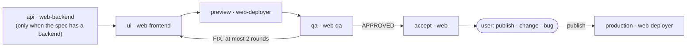

# Squad: Web

`squad.yaml` is the manifest, `scripts/` the deterministic tools, `skills/` what the bots load.

## Purpose

Someone who does not program gets their website or web app built, reviewed and live. The user describes a site, approves a plain-language plan, checks a preview and says "publish".

Several sites at once, each its own project folder and its own GitHub repository. Nothing reaches production, DNS, money or data without the user's explicit answer for that action.

## What the user sees

```text
🥐 Panadería Sol · preview ready (milestone 1 of 3: home and menu)
https://m1-panaderia-sol.example.workers.dev
- Home with opening hours and the map
- Menu page, in Spanish and English
- Loads in 1.2 s on a phone; no accessibility errors
📎 screenshot attached
Reply: "publish" · "change: ..." · "bug: ... + screenshot"
```

| The user says | What happens |
|---|---|
| `new site: a page for my bakery with the menu` | Questions in rounds of at most 5 (never technical), then a plan: pages, stack in one line, milestones, monthly cost |
| `ok` | `spec.md` approved; the milestone chain runs: backend (if any), frontend, preview, QA, acceptance |
| `publish` | One closed question with what goes live and what it costs; after a "yes": merge commit, production deploy, live URL |
| `change: add a gallery` · `bug: the form does not send` | A new work item and a new preview |
| `connect my domain` | Registrar steps, a confirmation before any DNS change, then HTTPS |
| `rollback` | After one confirmation, the previous version is live again |
| `status` | Per site: current milestone, last preview, live URL, what waits for the user |

## Bots

One visible lead (`web`) and four hidden workers; bots, lanes and keeps: `squad.yaml`.

Models come from the lanes in `scripts/data/model-roles.yaml`; the builder asks the user once and records the answer.

## Stack

Common: Tailwind, TypeScript, pnpm, Biome, Vitest, Playwright. Types, stacks and pinned versions: `skills/building-frontend/scripts/stacks.json`. Motion uses GSAP ScrollTrigger; 3D uses three.js with React Three Fiber (see `skills/building-frontend/references/`). Hosting is Cloudflare by default; a server-rendered site in production usually needs its paid plan, stated before the first deploy.

## Chain: milestone



`chain deploy-production` runs only after the user says "publish", with their literal confirmation in the card body.

## Cron

`web-watch` runs on the lead; schedule, script and delivery: `squad.yaml`. It prints to the lead's Bot Chat only when a card needs attention.

## What the computer needs

- The builder installs it; nothing else runs in the background (no Docker, no database, no server).
- Accounts the user creates: GitHub (free) and Cloudflare (free). The deployer guides a fine-grained GitHub token and a scoped Cloudflare token; both stay in its own environment.
- Node 22+, pnpm, git, `gh`, `cf` and Chrome are needed the first time a site builds; Playwright and Lighthouse run inside the site project.

## Files in this squad

| File | Contents |
|---|---|
| `squad.yaml` | Manifest: bots, lanes, chains, cron, keeps |
| `souls/` | One SOUL per bot |
| `skills/` | `leading-web`, `building-frontend`, `building-backend`, `reviewing-sites`, `deploying-sites`, `site-contract` |
| `scripts/` | `web_watch.py` (cron watchdog, copied into the lead profile) |
| `skills/building-frontend/scripts/` | `scaffold_site.py`, `stacks.json` (pinned framework and tool versions) |
| `skills/site-contract/scripts/` | `check_site.py` |
